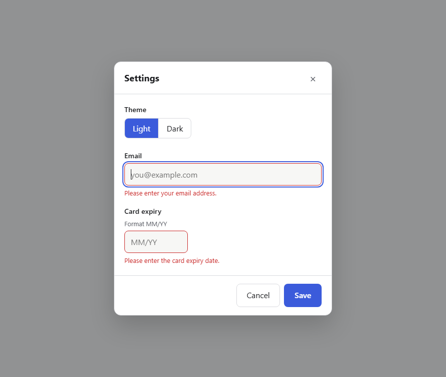

# modern-web-pitfalls

An [Agent Skill](https://docs.claude.com/en/docs/claude-code/skills) that stops AI coding agents from
making the ten web-development mistakes they make most often.

In November 2026 the Chrome team ran an eval suite on frontier models. Without guidance, the
models passed only about half of the best-practice checks for accessibility, UX, performance and
security. They don't write broken code. They write code from older habits: hand-rolled focus traps,
`touchmove` swipe physics, `setTimeout` task queues, DIY HTML sanitizers, `atob` passkey helpers. The
platform now has native primitives for all of these. This skill shows the agent what to use instead.

## Before / after

I gave two fresh agents the same prompt: *"a full-height hero, a Settings button that opens an
animated modal, a light/dark theme switcher that persists, and an email + card-expiry form with
validation."* One agent had the skill and one didn't.

<table>
  <tr>
    <th width="50%">Without skill</th>
    <th width="50%">With skill</th>
  </tr>
  <tr>
    <td></td>
    <td></td>
  </tr>
  <tr>
    <td></td>
    <td></td>
  </tr>
</table>

<sub>Both pages after clicking <b>Save</b> on an empty form, rendered in headless Chrome.</sub>

The two pages look alike, and that's expected. Both work, and a quick review would pass either one.
The differences show up for particular users, devices and situations:

### What you can see in the screenshots

| Difference | Why it matters |
|---|---|
| **Light / Dark / System** instead of a Light/Dark toggle | Once someone picks "Light" in a two-way toggle, the site stops following their OS. If their phone switches to dark mode at night, they still get a bright page, and there's no way back short of clearing storage. A **System** option keeps the user in control. |
| **⚠ icon** on each error, not red text alone | About 1 in 12 men have some colour-vision deficiency. If red is the only signal, some users can't tell which field is wrong. WCAG 1.4.1 (Use of Color) requires a second cue. |
| **Hint above the field** ("We'll send receipts here…") | On phones, the keyboard and the autofill popup cover whatever sits *below* an input. Format rules have to be readable while the user types. The baseline puts its email hint only in the `placeholder`, which disappears as soon as typing starts. |

### What you can't see, but users notice

| | Without skill | With skill | Why it matters |
|---|---|---|---|
| Checklist items passed | **6 / 17** | **17 / 17** | |
| Open/close animation | class toggle + `animationend` + `setTimeout` fallback | pure CSS: `@starting-style` + `transition-behavior: allow-discrete` | The JS version can get stuck half-closed when events race, for example a quick double-click or Esc during the animation. The CSS version is handled by the browser, with no timers to go wrong. |
| Reduced motion | `0.01ms` duration override | motion opted into with `prefers-reduced-motion: no-preference` | Sliding and zooming can cause nausea or dizziness for people with vestibular disorders. With an opt-in, nobody gets motion unless their system allows it. The skill version also keeps the gentle fade. |
| Dark-mode load | no `<meta name="color-scheme">` | meta tag + `light-dark()` | Without the meta tag, dark-mode users see a white flash on every page load, and the browser draws scrollbars and form controls in light mode. |
| Other tabs | out of sync until reload | synced via the `storage` event | If you change the theme in one tab, every other open tab updates too. |
| Validation | JS `blur` handlers | `:user-invalid` + synced `aria-invalid` | The browser only flags a field after the user has really interacted with it, and screen readers hear the same state that sighted users see. |
| Light dismiss | manual backdrop hit-testing | `closedby="any"` with a fallback | Native behaviour covers edge cases (touch, pen, nested popovers) that hand-written hit-tests miss. |

**The common thread:** each "with skill" choice gives the work to the browser, which already
handles accessibility, input methods and performance. That means less code to maintain and fewer
bugs, and it gets better as browsers improve.

Full code and every check: [`examples/settings-panel/`](examples/settings-panel/). This was one
prompt and one run, graded by hand, so treat it as a demo and not a benchmark.

## What it covers

| # | Area | The usual mistake | What the skill asks for |
|---|------|-------------------|--------------------------|
| 1 | Focus & `inert` | JS focus traps, `aria-modal` divs, a tab stop on every toolbar item | `<dialog>`/`inert`, focus return, roving tabindex, 3:1 focus rings |
| 2 | Reduced motion | Smooth scroll, scroll-driven animations and view transitions always on | Gate them behind `prefers-reduced-motion: no-preference`; no `0.01ms` blanket reset |
| 3 | Forms | `blur` validation, hints in `placeholder`, colour-only autofill styling | `:user-invalid`, synced `aria-invalid`, hints above the input, non-colour cues |
| 4 | Swipe gestures | `pointermove`/`touchmove` physics | CSS Scroll Snap, `overscroll-behavior-x`, scroll-driven animations |
| 5 | Dialogs & popovers | `position: fixed` overlays, rAF/`transitionend` animation, `popstate` hacks | `popover`, `<dialog>`, `@starting-style`, `transition-behavior: allow-discrete` |
| 6 | Dark mode | No `color-scheme`, binary toggle, out-of-sync tabs | `<meta name="color-scheme">`, `light-dark()`, Light/Dark/System, `storage` event |
| 7 | Responsiveness (INP) | `setTimeout` queues, `display: none` views, layout-forcing scroll listeners | `scheduler.yield()`/`postTask()`, `content-visibility`, scroll-state queries |
| 8 | Layout shift (CLS) | Unsized `<video>`, `100vh`, anti-flicker `opacity: 0` snippets | Sized media, `font-size-adjust`, `dvh`/`svh`, `blocking="render"`, `rel="expect"` |
| 9 | XSS & CSP | DIY `DOMParser` sanitizers, pass-through Trusted Types, `'self'` allowlists | `setHTML()` + lazy DOMPurify, hash/nonce CSP with `'strict-dynamic'` |
| 10 | Passkeys | `atob`/`btoa` helpers, no capability checks, stale credentials | WebAuthn JSON helpers, `getClientCapabilities()`, `signalUnknownCredential()`, `AbortSignal` |

Every rule says what to avoid, what to write instead, and gives a short snippet. Newer APIs are
always feature-detected with a working fallback.

## How it compares

Short version: **if you can install Google's official [Modern Web Guidance](https://github.com/GoogleChrome/modern-web-guidance),
do.** It's far larger, it's maintained by browser vendors, and it has a real eval suite. This
skill is the small, zero-dependency option. It's a checklist an agent can carry anywhere, and it
can run alongside the official one.

| Project | Maintained by | Focus | How it works | Size | Needs | License |
|---|---|---|---|---|---|---|
| **modern-web-pitfalls** (this) | Community (one person) | The 10 failure areas in Chrome's article: a11y, UX, perf, security | Plain-Markdown checklist, loaded when the agent writes front-end code, with 4 reference files read on demand | 1 skill, ~600 lines | Nothing. Works offline, and you can paste it into any rules file | MIT |
| [Modern Web Guidance](https://github.com/GoogleChrome/modern-web-guidance) | Chrome, Edge, Firefox and MDN teams | Modern web-platform features across UX, CSS layout, perf, forms, a11y and built-in AI | The skill calls a CLI that searches 200+ curated guides and pulls the relevant one into context. It also has a `legacy-scan` command for existing code | Large, with browser-compat data | Node.js (`npx`) | Apache-2.0 |
| [Vercel web-design-guidelines](https://github.com/vercel-labs/agent-skills) | Vercel | UI and interaction quality (Vercel's [Web Interface Guidelines](https://github.com/vercel-labs/web-interface-guidelines)) | An audit skill that fetches the latest rules at review time and reports issues as MUST/SHOULD/NEVER | Medium | Network access at review time | MIT (guidelines) |
| [Web Quality Skills](https://github.com/addyosmani/web-quality-skills) | Addy Osmani (community) | Lighthouse audits: perf, Core Web Vitals, a11y, SEO, best practices | 6 skills built around Lighthouse categories and CWV thresholds | Medium | Nothing | MIT |
| [frontend-design](https://github.com/anthropics/skills) | Anthropic | Visual design quality: distinctive, non-generic UI | Design-direction guidance for building interfaces | Small | Nothing | See repo |

### Where each one fits

- **Modern Web Guidance:** the most thorough and authoritative choice, covering all 10 of these
  areas and much more. The trade-offs are a Node/CLI dependency, a tool call for each lookup, and a
  bigger footprint.
- **modern-web-pitfalls:** use it when you want one short list the agent always sees, with no
  tooling. That suits locked-down environments, agents without shell access (such as the Claude app
  and Cowork), or pasting into `AGENTS.md`/`.cursorrules`. It's also easy to read and fork.
- **Vercel / Web Quality Skills:** these come at the problem from other angles, interface polish and
  Lighthouse scores, and they're mainly for **reviewing** finished code. They pair well with either
  of the above.
- **frontend-design:** this one is about how a page *looks*, not which platform APIs it uses. It's
  complementary, not a competitor.

### Honest limitations of this skill

- It covers **10 areas**, not the whole platform. If your problem isn't on the checklist, this skill
  won't help.
- It has **no browser-compat database**. It relies on feature detection and fallbacks instead.
- So far, the only evidence is **one before/after demo**, not an eval suite.
- One person maintains it. Corrections are very welcome.

<sub>Comparison as of November 2026, based on each project's public README. Features and scope change, so check each repo for the current details.</sub>

## Install

### Claude Code: as a plugin

```
/plugin marketplace add NAIRBS/modern-web-pitfalls
/plugin install modern-web-pitfalls@modern-web-pitfalls
```

### Claude Code: as a personal skill

```bash
git clone https://github.com/NAIRBS/modern-web-pitfalls.git
cp -r modern-web-pitfalls/skills/modern-web-pitfalls ~/.claude/skills/
```

To use it in one project only, copy it into that project's `.claude/skills/` folder.

### Claude app / Cowork (no git needed)

Download `modern-web-pitfalls-skill.zip` from the
[latest release](https://github.com/NAIRBS/modern-web-pitfalls/releases/latest). In Claude, go to
**Customize → Skills → + → Create skill → Upload a skill**, then turn the skill on.

### Other agents

`skills/modern-web-pitfalls/SKILL.md` is plain Markdown with YAML frontmatter, so any agent that
supports the Agent Skills format can load it. For tools that don't, paste the **Checklist** section
of `SKILL.md` into your rules file (`AGENTS.md`, `.cursorrules`, `copilot-instructions.md`, …) and
link to the reference files.

## Layout

```
skills/modern-web-pitfalls/
├── SKILL.md                  # when to trigger + the full checklist
└── references/
    ├── accessibility.md      # 1–3: focus/inert, reduced motion, forms
    ├── ux.md                 # 4–6: gestures, dialogs/popovers, dark mode
    ├── performance.md        # 7–8: INP, CLS and flicker
    └── security.md           # 9–10: XSS/CSP, passkeys
```

The agent always sees the checklist. It opens a reference file only when the task touches that area.

## How to use it

You don't need to do anything special. The skill triggers whenever the agent writes or reviews
HTML, CSS or front-end JS. You can also ask for it directly:

> Review `src/components/` against the modern-web-pitfalls checklist.

## Credits

The ten areas come from Philip Walton's article
[*Top 10 things AI gets wrong in web dev*](https://developer.chrome.com/blog/top-10-things-ai-gets-wrong-in-web-dev)
on Chrome for Developers. The wording and code examples here are my own. For Google's official and
much larger guidance set, see **Modern Web Guidance**:

```bash
npx modern-web-guidance@latest install
```

This project is not affiliated with Google or the Chrome team.

## Contributing

Browser support moves fast. If a rule is out of date or a snippet is wrong, open an issue or PR.

## License

[MIT](LICENSE)
