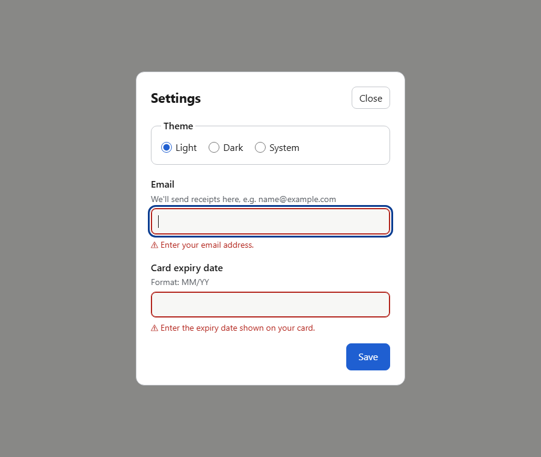
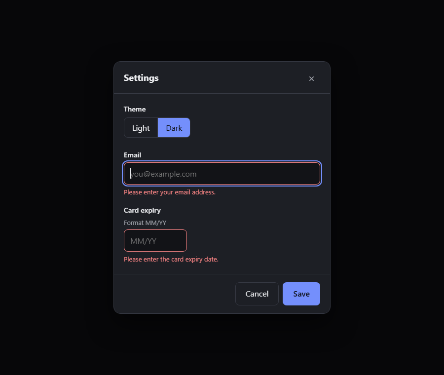
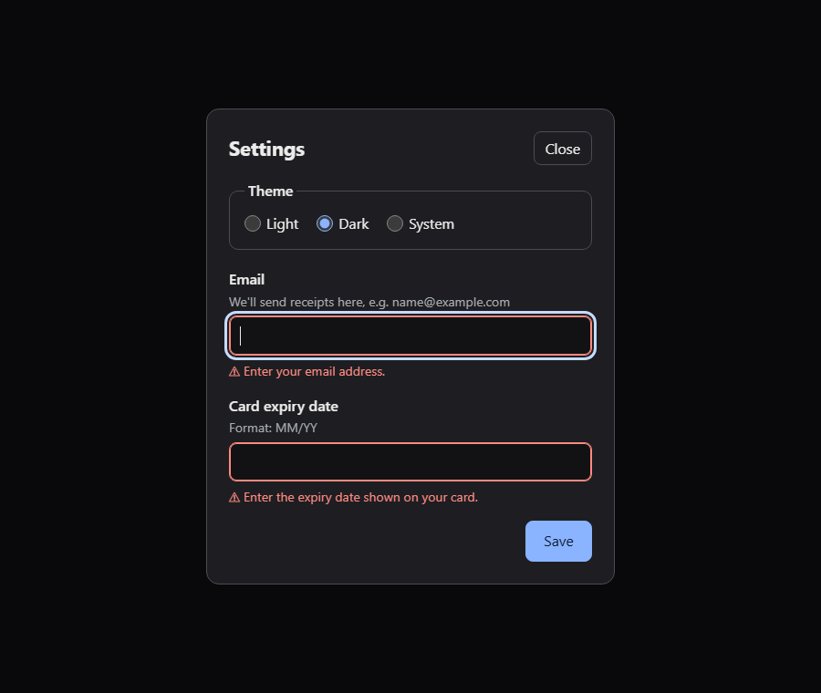

# modern-web-pitfalls

An [Agent Skill](https://docs.claude.com/en/docs/claude-code/skills) that stops AI coding agents from
making the ten web-development mistakes they make most often.

In November 2026 the Chrome team ran an eval suite on frontier models. Without guidance, the
models passed only about half of the best-practice checks for accessibility, UX, performance and
security. They don't write broken code. They write code from older habits: hand-rolled focus traps,
`touchmove` swipe physics, `setTimeout` task queues, DIY HTML sanitizers, `atob` passkey helpers. The
platform now has native primitives for all of these. This skill shows the agent what to use instead.

## Before / after

I gave two fresh agents the same prompt: *"a full-height hero, a Settings button that opens an
animated modal, a light/dark theme switcher that persists, and an email + card-expiry form with
validation."* One agent had the skill and one didn't.

<table>
  <tr>
    <th width="50%">Without skill</th>
    <th width="50%">With skill</th>
  </tr>
  <tr>
    <td></td>
    <td></td>
  </tr>
  <tr>
    <td></td>
    <td></td>
  </tr>
</table>

<sub>Both pages after clicking <b>Save</b> on an empty form, rendered in headless Chrome.</sub>

The two pages look alike, and that's expected. The visible differences are a **System** theme
option, a ⚠ icon on each error (a cue that doesn't rely on colour) and a hint above the email field.
Most of the difference is in the code underneath:

| | Without skill | With skill |
|---|---|---|
| Checklist items passed | **6 / 17** | **17 / 17** |
| Open/close animation | class toggle + `animationend` + `setTimeout` fallback | pure CSS: `@starting-style` + `transition-behavior: allow-discrete` |
| Reduced motion | `0.01ms` duration override | motion opted into with `prefers-reduced-motion: no-preference` |
| Theme | binary toggle, no `<meta name="color-scheme">`, duplicated tokens | Light / Dark / **System**, `light-dark()`, meta tag, tabs synced |
| Validation | JS `blur` handlers | `:user-invalid` + synced `aria-invalid` |
| Light dismiss | manual backdrop hit-testing | `closedby="any"` with a fallback |

Full code and every check: [`examples/settings-panel/`](examples/settings-panel/). This was one
prompt and one run, graded by hand, so treat it as a demo and not a benchmark.

## What it covers

| # | Area | The usual mistake | What the skill asks for |
|---|------|-------------------|--------------------------|
| 1 | Focus & `inert` | JS focus traps, `aria-modal` divs, a tab stop on every toolbar item | `<dialog>`/`inert`, focus return, roving tabindex, 3:1 focus rings |
| 2 | Reduced motion | Smooth scroll, scroll-driven animations and view transitions always on | Gate them behind `prefers-reduced-motion: no-preference`; no `0.01ms` blanket reset |
| 3 | Forms | `blur` validation, hints in `placeholder`, colour-only autofill styling | `:user-invalid`, synced `aria-invalid`, hints above the input, non-colour cues |
| 4 | Swipe gestures | `pointermove`/`touchmove` physics | CSS Scroll Snap, `overscroll-behavior-x`, scroll-driven animations |
| 5 | Dialogs & popovers | `position: fixed` overlays, rAF/`transitionend` animation, `popstate` hacks | `popover`, `<dialog>`, `@starting-style`, `transition-behavior: allow-discrete` |
| 6 | Dark mode | No `color-scheme`, binary toggle, out-of-sync tabs | `<meta name="color-scheme">`, `light-dark()`, Light/Dark/System, `storage` event |
| 7 | Responsiveness (INP) | `setTimeout` queues, `display: none` views, layout-forcing scroll listeners | `scheduler.yield()`/`postTask()`, `content-visibility`, scroll-state queries |
| 8 | Layout shift (CLS) | Unsized `<video>`, `100vh`, anti-flicker `opacity: 0` snippets | Sized media, `font-size-adjust`, `dvh`/`svh`, `blocking="render"`, `rel="expect"` |
| 9 | XSS & CSP | DIY `DOMParser` sanitizers, pass-through Trusted Types, `'self'` allowlists | `setHTML()` + lazy DOMPurify, hash/nonce CSP with `'strict-dynamic'` |
| 10 | Passkeys | `atob`/`btoa` helpers, no capability checks, stale credentials | WebAuthn JSON helpers, `getClientCapabilities()`, `signalUnknownCredential()`, `AbortSignal` |

Every rule says what to avoid, what to write instead, and gives a short snippet. Newer APIs are
always feature-detected with a working fallback.

## Install

### Claude Code: as a plugin

```
/plugin marketplace add NAIRBS/modern-web-pitfalls
/plugin install modern-web-pitfalls@modern-web-pitfalls
```

### Claude Code: as a personal skill

```bash
git clone https://github.com/NAIRBS/modern-web-pitfalls.git
cp -r modern-web-pitfalls/skills/modern-web-pitfalls ~/.claude/skills/
```

To use it in one project only, copy it into that project's `.claude/skills/` folder.

### Claude app / Cowork (no git needed)

Download `modern-web-pitfalls-skill.zip` from the
[latest release](https://github.com/NAIRBS/modern-web-pitfalls/releases/latest). In Claude, go to
**Customize → Skills → + → Create skill → Upload a skill**, then turn the skill on.

### Other agents

`skills/modern-web-pitfalls/SKILL.md` is plain Markdown with YAML frontmatter, so any agent that
supports the Agent Skills format can load it. For tools that don't, paste the **Checklist** section
of `SKILL.md` into your rules file (`AGENTS.md`, `.cursorrules`, `copilot-instructions.md`, …) and
link to the reference files.

## Layout

```
skills/modern-web-pitfalls/
├── SKILL.md                  # when to trigger + the full checklist
└── references/
    ├── accessibility.md      # 1–3: focus/inert, reduced motion, forms
    ├── ux.md                 # 4–6: gestures, dialogs/popovers, dark mode
    ├── performance.md        # 7–8: INP, CLS and flicker
    └── security.md           # 9–10: XSS/CSP, passkeys
```

The agent always sees the checklist. It opens a reference file only when the task touches that area.

## How to use it

You don't need to do anything special. The skill triggers whenever the agent writes or reviews
HTML, CSS or front-end JS. You can also ask for it directly:

> Review `src/components/` against the modern-web-pitfalls checklist.

## Credits

The ten areas come from Philip Walton's article
[*Top 10 things AI gets wrong in web dev*](https://developer.chrome.com/blog/top-10-things-ai-gets-wrong-in-web-dev)
on Chrome for Developers. The wording and code examples here are my own. For Google's official and
much larger guidance set, see **Modern Web Guidance**:

```bash
npx modern-web-guidance@latest install
```

This project is not affiliated with Google or the Chrome team.

## Contributing

Browser support moves fast. If a rule is out of date or a snippet is wrong, open an issue or PR.

## License

[MIT](LICENSE)
