# Holdout test: product page

This is the **unseen** task. After v1.1 of the skill was written, I wrote a new task and its
[rubric](grading/RUBRIC.md) and committed both to GitHub *before* any page was built (see commit
`61f0adc`). None of the skills, including this one, was tuned on this task.

> Build a single-file product page (plain HTML/CSS/JS, no frameworks or external libraries) for a
> fictional pair of headphones, "Aria One", $249:
> - A hero that fills the phone screen, with product name, price and an "Add to cart" button.
> - A swipeable image carousel of 5 product images (use inline SVG placeholders) that works with touch swipe, prev/next buttons, and slide indicators.
> - A "See it in action" section with the product video at /media/demo.mp4 (1280×720).
> - Headings use the self-hosted web font "Brand Sans" from /fonts/brand-sans.woff2 with a system font fallback.
> - A reviews section that renders 300 generated reviews (name, 1–5 star rating, text) with a "Filter by rating" control that updates the list.
> - A "Review guidelines" button that opens a small non-modal panel, which closes on outside click or Esc.

This task covers areas the settings panel didn't: swipe gestures, layout shift (video and fonts),
long-list performance and popovers.

## Results (blind-graded)

| Skill | Page | Part A: platform (14) | Part B: basics (10) | Total (24) |
|---|---|:-:|:-:|:-:|
| **modern-web-pitfalls v1.1** | [`modern-web-pitfalls.html`](modern-web-pitfalls.html) | **14** | **10** | **24** |
| [Web Quality Skills](https://github.com/addyosmani/web-quality-skills) | [`web-quality-skills.html`](web-quality-skills.html) | 12 | **10** | 22 |
| [Modern Web Guidance](https://github.com/GoogleChrome/modern-web-guidance) | [`modern-web-guidance.html`](modern-web-guidance.html) | 12 | 9 | 21 |
| [frontend-design](https://github.com/anthropics/skills) | [`frontend-design.html`](frontend-design.html) | 13 | 8 | 21 |
| [Vercel web-design-guidelines](https://github.com/vercel-labs/agent-skills) | [`vercel-web-design-guidelines.html`](vercel-web-design-guidelines.html) | 11 | 9 | 20 |
| *No skill* | [`without-skill.html`](without-skill.html) | 11 | 9 | 20 |

### What separated them

| Check | Who failed it |
|---|---|
| **H5:** slide tracking without a layout-reading `scroll` listener | Modern Web Guidance (a rAF-throttled `scroll` + `getBoundingClientRect`) |
| **H7:** metric-matched font fallback (`font-size-adjust`/`size-adjust`) | Web Quality Skills, Vercel, no skill |
| **H11:** native `popover` for the guidelines panel | Web Quality Skills, Vercel, no skill (custom overlays + document click handlers) |
| **H14:** a CSP | Everyone except modern-web-pitfalls and Web Quality Skills |
| **G3:** UI borders ≥ 3:1 | Modern Web Guidance, frontend-design, Vercel, no skill (borders around 1.4–1.6:1) |
| **G4:** not colour alone | frontend-design (filled and empty stars use the same ★ glyph in different colours) |

**Honest read:** this task was easier for every agent than the settings panel. The no-skill
baseline scored 20/24, so the gaps are a few points, not a rout. Part A is taken from the Chrome
article that this skill is based on, and Modern Web Guidance covers the same ground, so Part A still
leans toward these two. The v1.1 baseline-quality additions are what earned the perfect score on
Part B. Without them the page would most likely have failed G3, as four others did.

## Screenshots

Phone-width (540×960) renders in headless Chrome, showing the hero and then the carousel section.

| | Hero | Carousel |
|---|---|---|
| modern-web-pitfalls v1.1 | 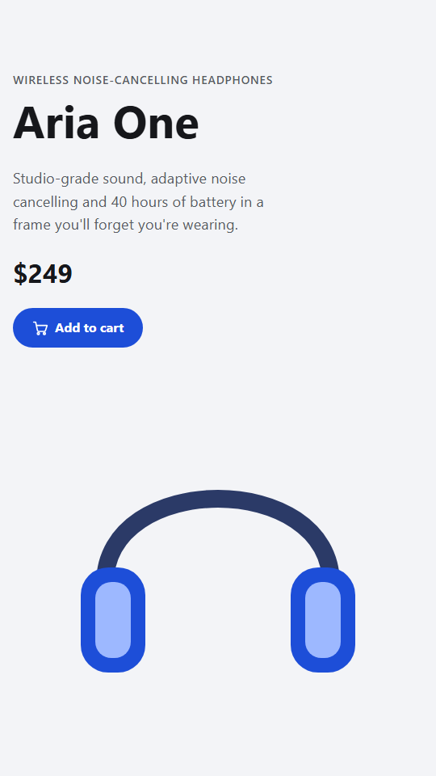 | 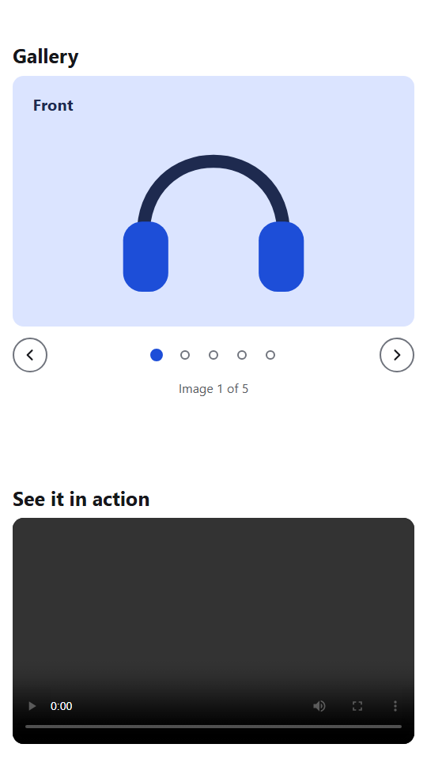 |
| Modern Web Guidance | 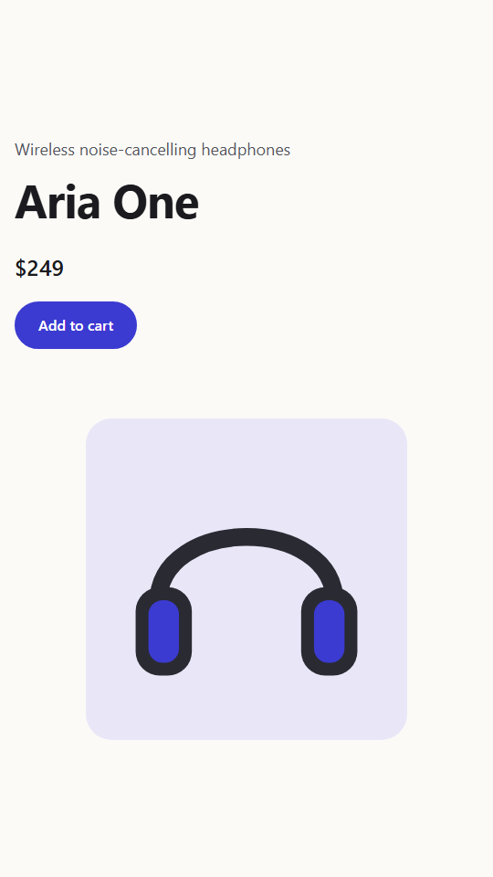 | 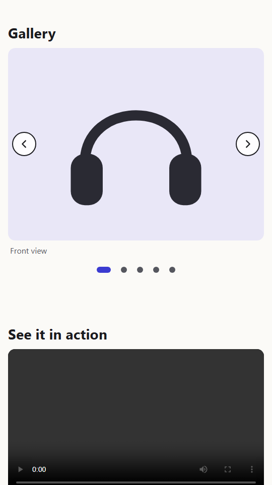 |
| Web Quality Skills | 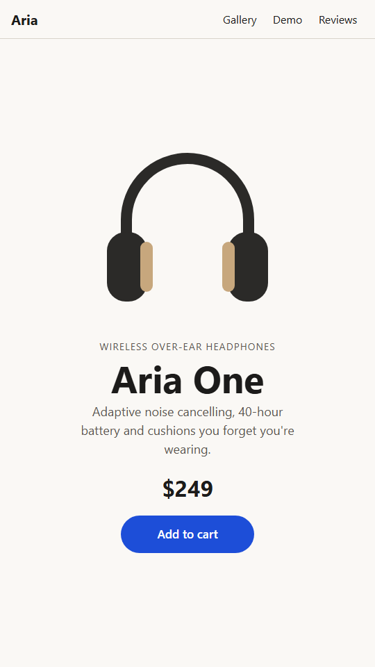 | 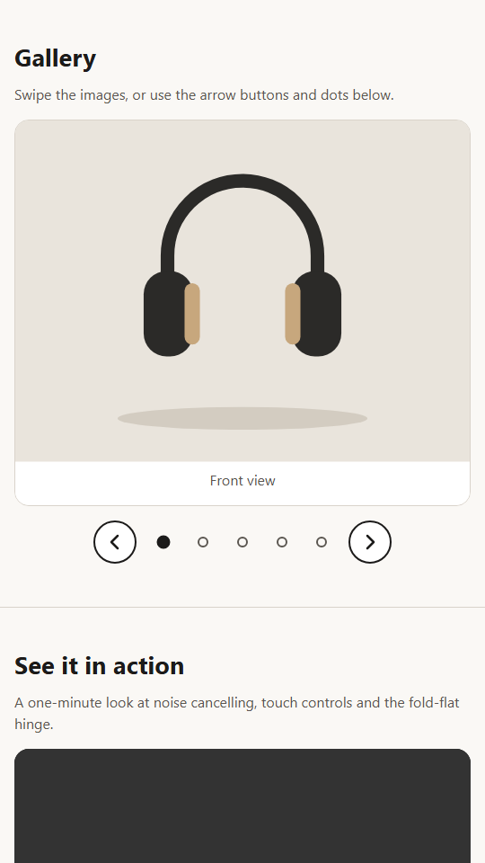 |
| Vercel guidelines | 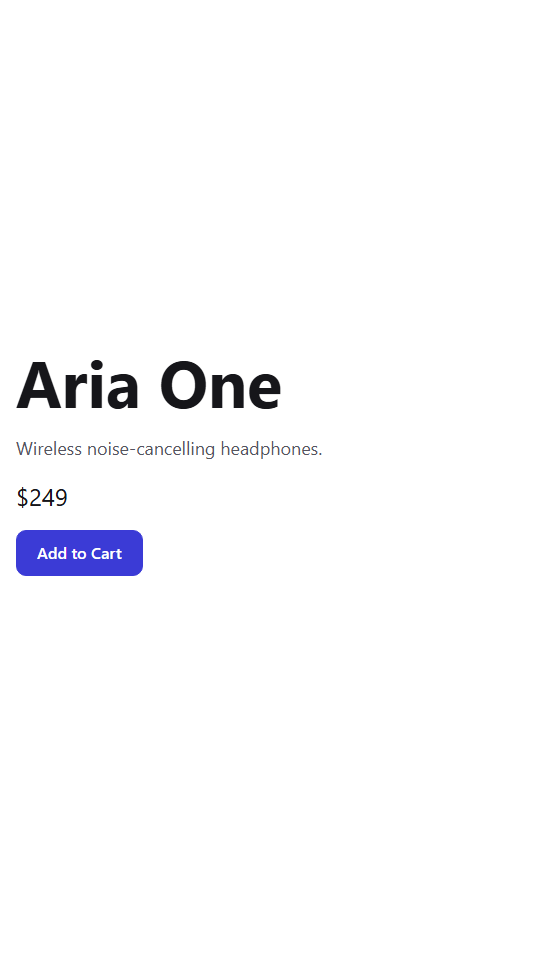 | 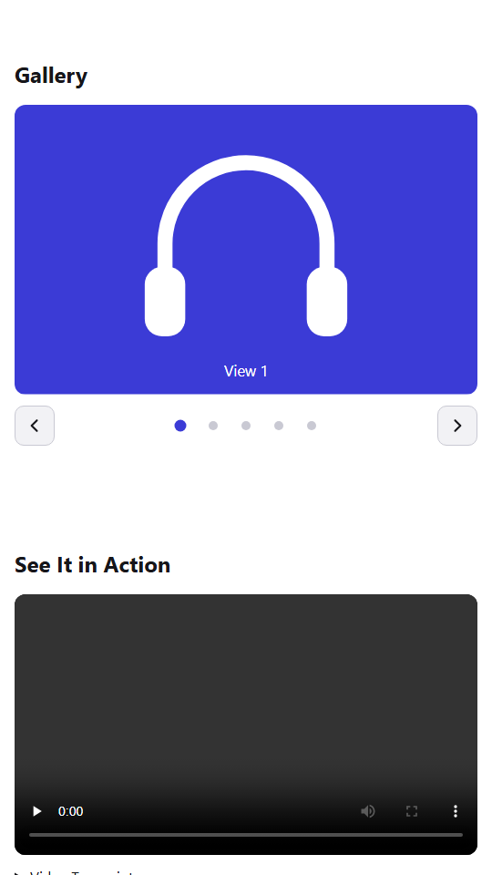 |
| frontend-design | 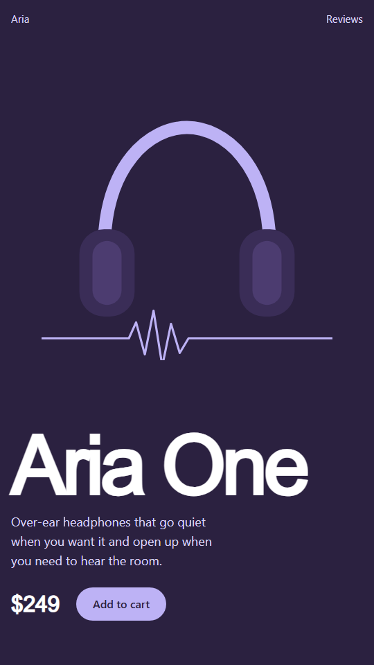 | 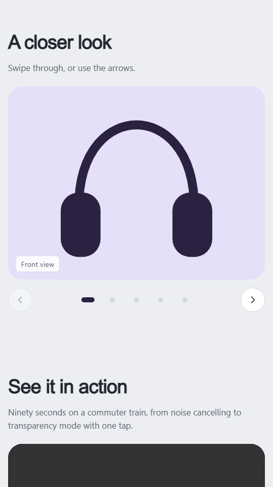 |
| No skill | 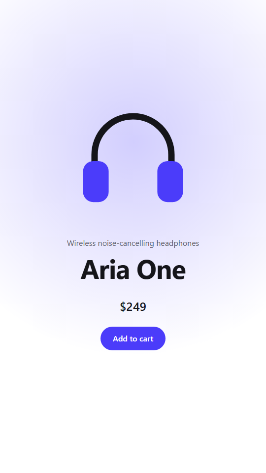 | 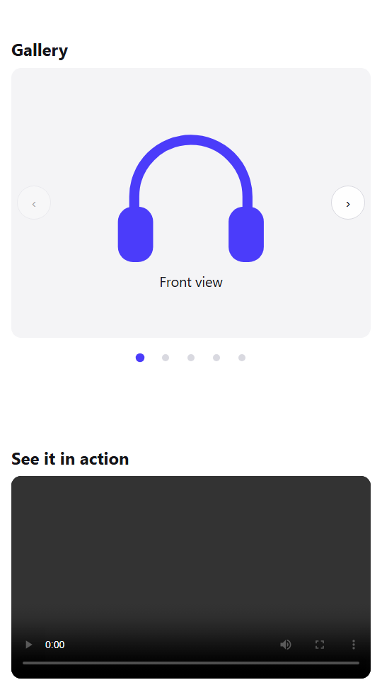 |

## Method

The method is the same as the [settings-panel test](../settings-panel/README.md#method): fresh
agents, each skill used the way its docs describe, then one blind grader working from shuffled
names (`page-J` … `page-O`) who quoted code for every verdict. The grader recomputed the CSP hashes
on the two pages that have one, and both match. The full verdicts and the ID mapping are in
[`grading/results.json`](grading/results.json).

## Limitations

- One run per skill and one grader, which is itself an LLM. Expect a point or two of noise.
- Code-only grading. The video and font files don't exist, and nothing was performance-profiled.
- The author of this repo wrote the rubric. Pre-registering it limits how it could be bent, but it doesn't remove the bias.
