# Head-to-head: settings panel

The same prompt went to six fresh Claude agents (Claude Opus 5.5, November 2026). Each had one web
skill installed, or none. Nothing else differed.

> Build a single-file page (plain HTML/CSS/JS, no frameworks or external libraries) with:
> - A full-height hero section at the top with a "Settings" button.
> - Clicking it opens a modal settings dialog with an animated open/close.
> - Inside the dialog: a theme switcher (light/dark) that persists across reloads, and a small form
>   with an email field and a card expiry field (MM/YY) with validation and helpful error messages,
>   plus a Save button.

## Round 2 (after v1.1): re-run and re-grade

After round 1, I improved the skill into v1.1, adding a baseline-quality checklist (see below for
what round 1 found). I then re-ran this task with v1.1, and a **new** blind grader scored all seven
pages: the six from round 1 plus the v1.1 page.

| Skill | Page | Part A (17) | Part B (10) | Total (27) |
|---|---|:-:|:-:|:-:|
| **modern-web-pitfalls v1.1** | [`with-skill-v1.1.html`](with-skill-v1.1.html) | **17** | **10** | **27** |
| modern-web-pitfalls v1.0 | [`with-skill.html`](with-skill.html) | 17 | 10* | 27* |
| Modern Web Guidance | [`modern-web-guidance.html`](modern-web-guidance.html) | 14 | 10 | 24 |
| Web Quality Skills | [`web-quality-skills.html`](web-quality-skills.html) | 10 | 10 | 20 |
| *No skill* | [`without-skill.html`](without-skill.html) | 6 | 9 | 15 |
| Vercel web-design-guidelines | [`vercel-web-design-guidelines.html`](vercel-web-design-guidelines.html) | 7 | 8 | 15 |
| frontend-design | [`frontend-design.html`](frontend-design.html) | 5 | 8 | 13 |

\* The round-2 grader treated faint input borders as a note, not a failure. Measured against WCAG
1.4.11, v1.0's borders are **1.6:1 / 2.2:1** (light/dark), which fails the 3:1 minimum. v1.1's are
**4.4–4.8:1 / 5.3–5.9:1**, which passes. Under the strict reading, v1.0 scores 26 and v1.1 scores 27.

**Grader agreement:** the two blind graders gave **identical Part A scores** to all six round-1
pages. Part B differed by at most one point per page, almost always on how strictly to read border
contrast. Full verdicts: [`grading/results-round2.json`](grading/results-round2.json).

v1.1 also shows visible changes: errors get an icon and "Error:" text, required fields are marked,
there are specific messages for each failure, focus moves to the first invalid field, and the
selected theme gets a ✓ as well as a colour change.

| v1.1 light | v1.1 dark |
|---|---|
| 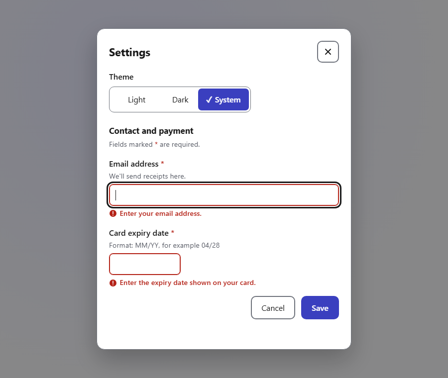 |  |

For a test on a task that **no skill was tuned on**, see the [product-page holdout](../product-page/).

## Round 1 results

| Skill | Page | Part A: modern platform (17) | Part B: quality basics (10) | Total (27) |
|---|---|:-:|:-:|:-:|
| modern-web-pitfalls (this repo) | [`with-skill.html`](with-skill.html) | **17** | 9 | **26** |
| [Modern Web Guidance](https://github.com/GoogleChrome/modern-web-guidance) | [`modern-web-guidance.html`](modern-web-guidance.html) | 14 | **10** | 24 |
| [Web Quality Skills](https://github.com/addyosmani/web-quality-skills) | [`web-quality-skills.html`](web-quality-skills.html) | 10 | **10** | 20 |
| *No skill* | [`without-skill.html`](without-skill.html) | 6 | 8 | 14 |
| [Vercel web-design-guidelines](https://github.com/vercel-labs/agent-skills) | [`vercel-web-design-guidelines.html`](vercel-web-design-guidelines.html) | 7 | 7 | 14 |
| [frontend-design](https://github.com/anthropics/skills) | [`frontend-design.html`](frontend-design.html) | 5 | 8 | 13 |

**Part A is this repo's own checklist**, so this skill is expected to top it. Part B is a set of
general basics that no skill owns: labels, keyboard use, contrast, error announcements, input types,
expiry edge cases, theme flash and bugs. On Part B, the official Modern Web Guidance and Web Quality
Skills both scored 10/10 and beat this skill.

### What each run showed

- **modern-web-pitfalls:** passed every Part A check. It failed **B6 contrast**: the input borders
  are about 1.6:1 in light mode and 2.2:1 in dark mode, below the 3:1 that WCAG 1.4.11 requires.
  That rule has since been added to the skill's checklist, but the test hasn't been re-run.
- **Modern Web Guidance:** the most complete page overall, with a System/Light/Dark control,
  `light-dark()`, `:user-invalid`, `closedby` and icon-plus-text errors. It failed A11 only because
  it adds a JS exit-animation path for browsers that can't animate the close natively. That's
  arguably good engineering, and the strict rubric still marks it FAIL. It also failed A15 (no
  `:autofill` cue) and A17 (no CSP).
- **Web Quality Skills:** perfect on the basics. It set a hash-based CSP with Trusted Types, and
  the hashes check out. It also had forced-colours support and 44px touch targets. On the modern
  platform checks it mostly used older patterns: a JS class plus `animationend`, a `0.01ms`
  reduced-motion override, no `:user-invalid` and no System option.
- **No skill:** clean, working code, with a native `<dialog>` and `dvh`. The gaps are the patterns
  the Chrome article describes: JS-driven animation, a `0.01ms` override, a binary theme toggle and
  errors shown by colour alone.
- **Vercel web-design-guidelines:** the agent fixed 35 review findings (copy, focus, `aria-live`,
  URL state). It also introduced a **real bug**: the backdrop handler checks
  `e.target === dialog`, so clicking inside the dialog's own padding closes it. The skill is built
  for reviewing UI polish, not for choosing platform APIs.
- **frontend-design:** by far the most distinctive design, a botanical theme with a serif display
  font. Platform correctness isn't its goal, and it scored that way. Pair it with one of the others.

## Screenshots

Each page after clicking **Save** on an empty form, rendered in headless Chrome at 900×760.

| | Light | Dark |
|---|---|---|
| No skill | 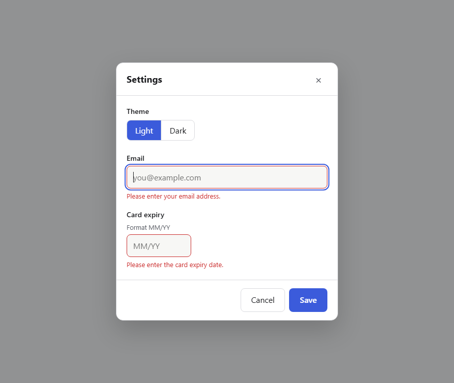 |  |
| modern-web-pitfalls | 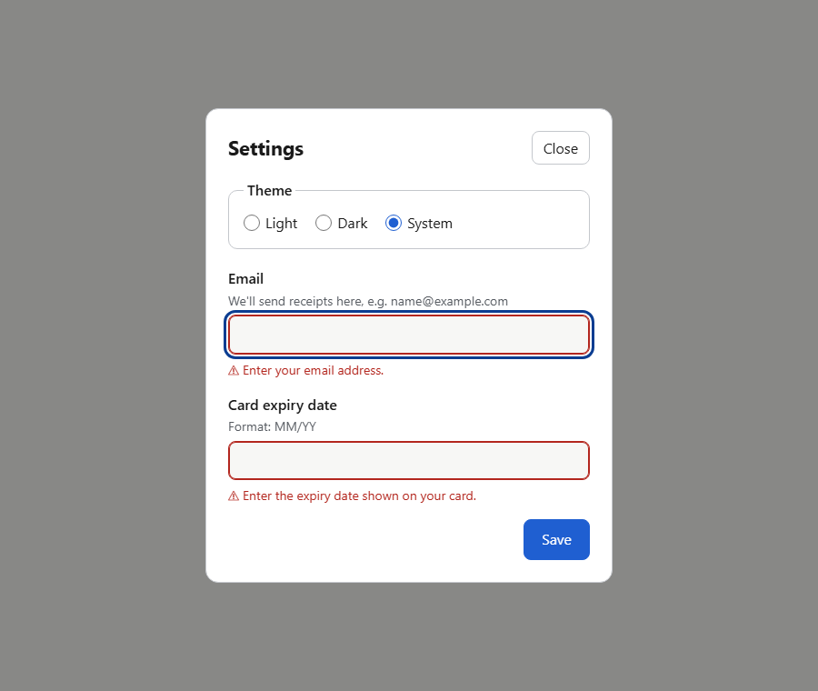 |  |
| Modern Web Guidance | 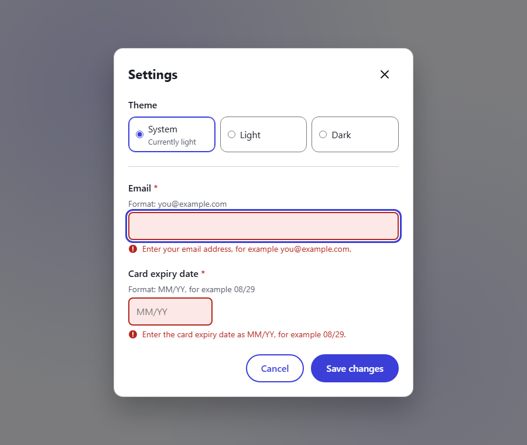 | 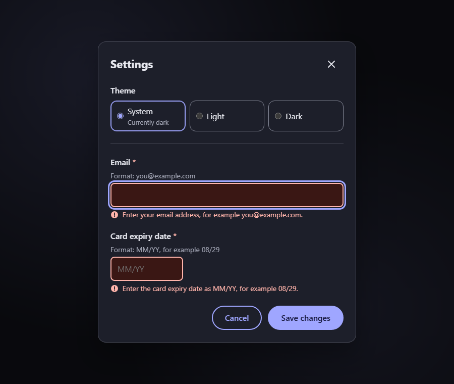 |
| Web Quality Skills | 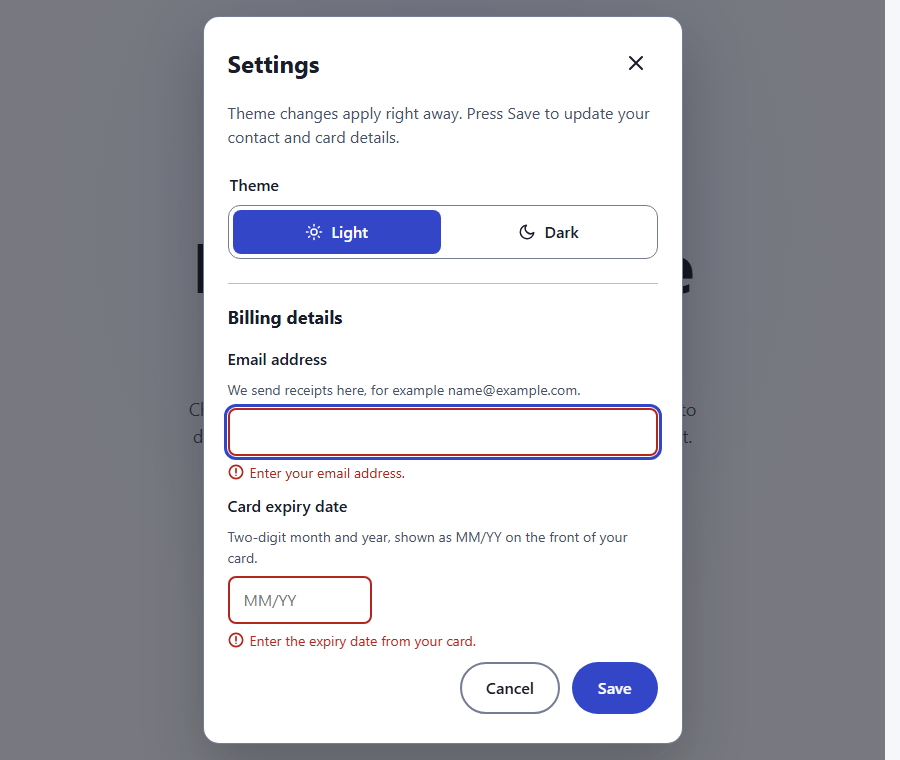 | 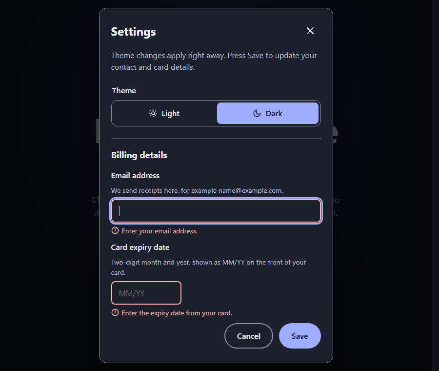 |
| Vercel guidelines | 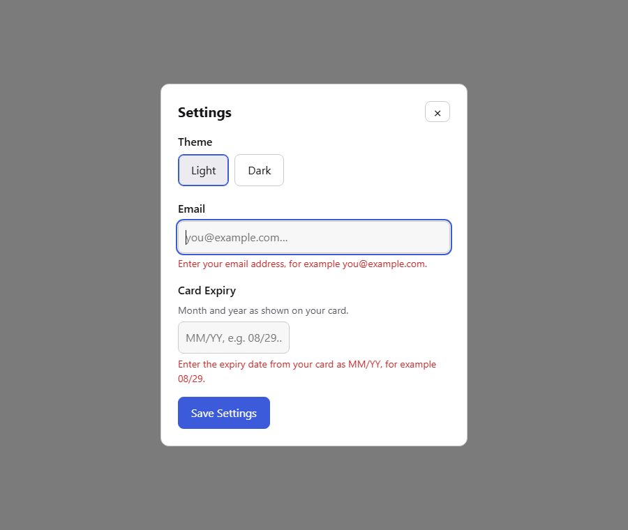 | 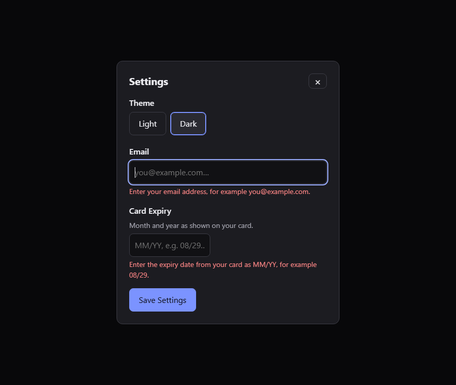 |
| frontend-design | 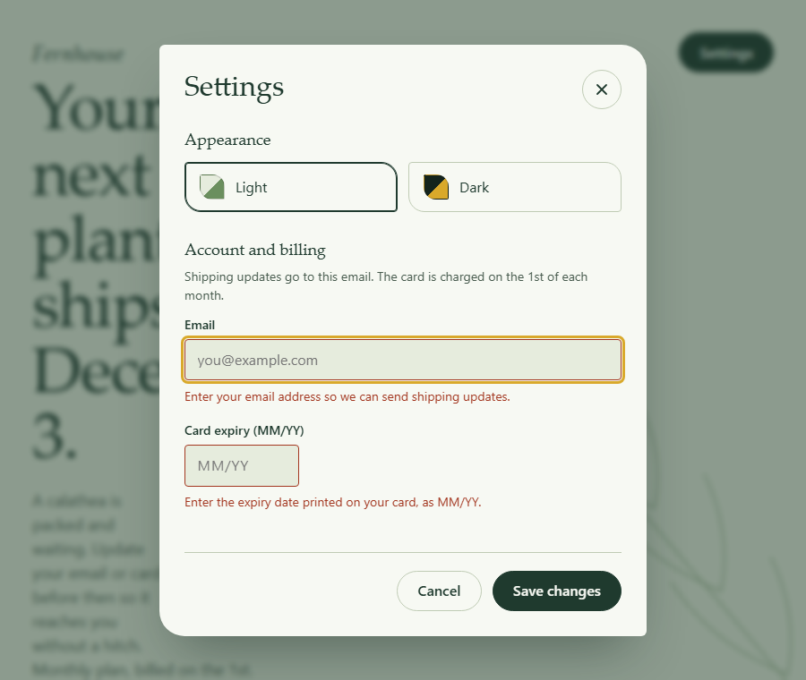 | 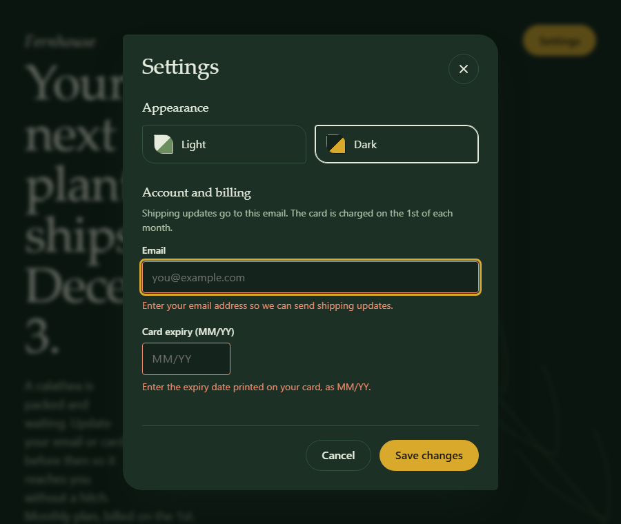 |

## Method

1. **Build.** Every agent got the prompt above with one skill's files available locally. Each skill
   was used the way its docs describe:
   - **modern-web-pitfalls, frontend-design:** read the skill, then build.
   - **Modern Web Guidance:** follow its search, retrieve and verify workflow. Its `npx` CLI needs
     Node.js, which wasn't available, so the agent searched and read the **same bundled guide files**
     directly. It read 10 guides.
   - **Vercel web-design-guidelines:** a review skill. Build, review against its pinned rules
     (`command.md`), then fix every finding.
   - **Web Quality Skills:** read the relevant skills, build, audit with `web-quality-audit` by
     reading the code (Lighthouse couldn't run), then fix the findings.
   - **No skill:** the prompt only.
2. **Blind grading.** The six files were copied under shuffled names (`page-P` … `page-U`) and
   graded by a separate agent that didn't know which skill made which page. It used a fixed
   [rubric](grading/RUBRIC.md) and quoted code for every verdict. The full verdicts and the ID
   mapping are in [`grading/results.json`](grading/results.json).
3. **Sanity checks.** The Web Quality Skills page sets a hash-based CSP. Its SHA-256 hashes were
   recomputed independently and match. (`.gitattributes` keeps these files on LF line endings so
   the hashes stay valid.) To take its screenshots, the CSP was removed from a temporary copy so the
   screenshot script could open the dialog. The file in this folder is unchanged.

## Limitations

- **One prompt and one run per skill.** LLM output varies, so another run could move scores by a
  few points.
- **One grader, and that grader is also an LLM.** The verdicts are reproducible from the quoted
  code, but they weren't checked by a person.
- **Part A was written by the author of one of the competitors**, namely this repo. Weigh Part B more.
- **One task.** A settings dialog exercises dialogs, theming and forms. It doesn't test gestures,
  performance or passkeys, where the skills may rank differently.
- **No cross-browser testing.** The grading is from code, and the screenshots come from Chrome only.
