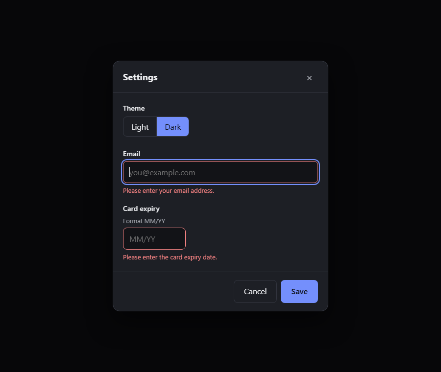
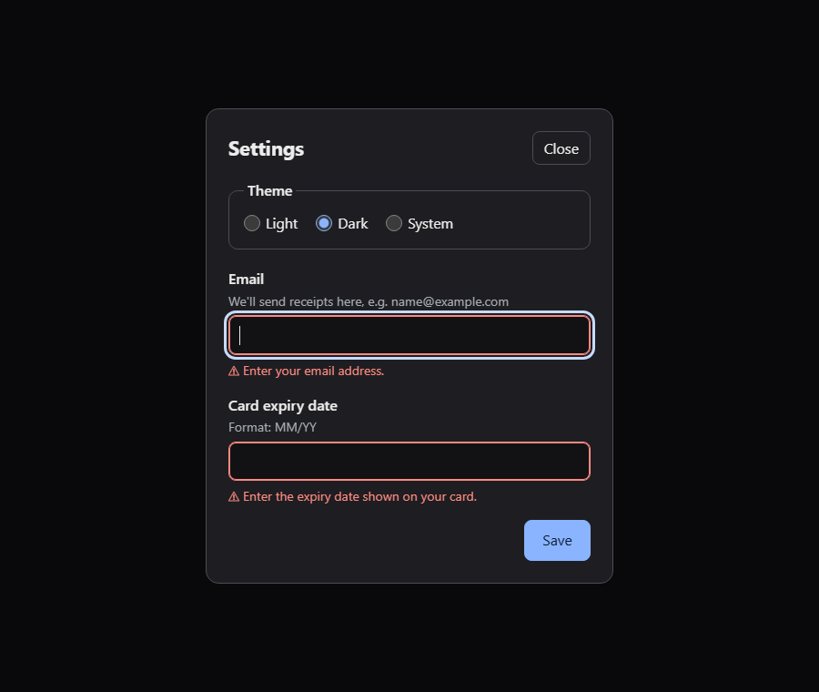

# Before / after: settings panel

The same prompt went to two fresh Claude agents (Claude Opus 5.5, November 2026). One had no
skill. The other read `modern-web-pitfalls` first. Nothing else differed.

> Build a single-file page (plain HTML/CSS/JS, no frameworks or external libraries) with:
> - A full-height hero section at the top with a "Settings" button.
> - Clicking it opens a modal settings dialog with an animated open/close.
> - Inside the dialog: a theme switcher (light/dark) that persists across reloads, and a small form
>   with an email field and a card expiry field (MM/YY) with validation and helpful error messages,
>   plus a Save button.

- Without the skill: [`without-skill.html`](without-skill.html)
- With the skill: [`with-skill.html`](with-skill.html)

## Screenshots

Both pages after clicking **Save** on an empty form, rendered in headless Chrome at 900×760.

| | Without skill | With skill |
|---|---|---|
| Light |  |  |
| Dark |  |  |

The visible differences are the **System** theme option, a ⚠ icon on errors (so they don't rely on
colour alone) and a hint above the email field. The rest of the improvements are in the code and
are listed below.

## Result: 6 / 17 → 17 / 17 checklist items

| Check (from the skill's checklist) | Without | With |
|---|:-:|:-:|
| Modal is a native `<dialog>` opened with `showModal()` | ✅ | ✅ |
| Focus returns to the trigger on close | ✅ | ✅ |
| `color-scheme` set in CSS (native controls follow the theme) | ✅ | ✅ |
| `aria-invalid` matches the visible error | ✅ | ✅ |
| Format hint is visible text above the input, linked with `aria-describedby` | ✅ | ✅ |
| Full-height hero uses `dvh`/`svh`, not bare `vh` | ✅ | ✅ |
| `<meta name="color-scheme" content="light dark">` in `<head>` | ❌ | ✅ |
| Theme tokens use `light-dark()` | ❌ | ✅ |
| Theme control has a **System** option | ❌ | ✅ |
| Other tabs stay in sync (`storage` event) | ❌ | ✅ |
| Open/close animated in pure CSS (`@starting-style`, `allow-discrete`) | ❌ class toggle + `animationend` + `setTimeout` fallback | ✅ |
| Movement opted **into** with `prefers-reduced-motion: no-preference` | ❌ `0.01ms` duration override | ✅ |
| Native light dismiss (`closedby="any"`) with a fallback | ❌ manual backdrop hit-test only | ✅ |
| Errors shown via `:user-invalid`, not JS `blur` handlers | ❌ | ✅ |
| `:autofill` styled with a non-colour cue | ❌ | ✅ |
| Dialog contains scroll (`overscroll-behavior: contain`) | ❌ | ✅ |
| Suggests a CSP for the page | ❌ | ✅ |

## Read this before quoting the number

- It's **one prompt and one run per side**, graded by hand against this skill's own checklist.
  That shows what the skill changes. It isn't a benchmark.
- The baseline is good code. It uses `<dialog>`, returns focus, sizes the hero with `dvh` and
  keeps `aria-invalid` in sync. The skill's gains are in the newer platform features, which is what
  the Chrome team's evals found too.
- Both pages were reviewed by reading the code. They weren't tested across browsers. `closedby`
  and `@starting-style` need recent browsers, and the with-skill page includes fallbacks.
